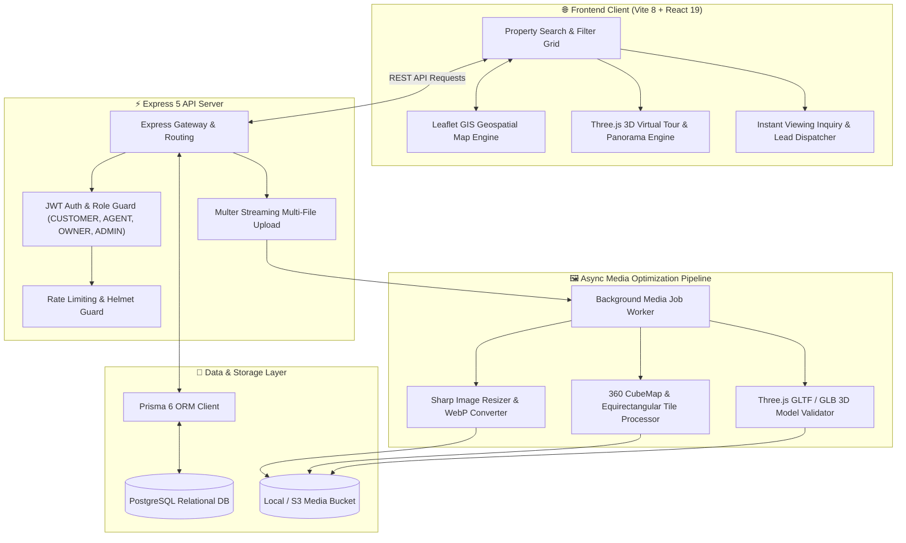
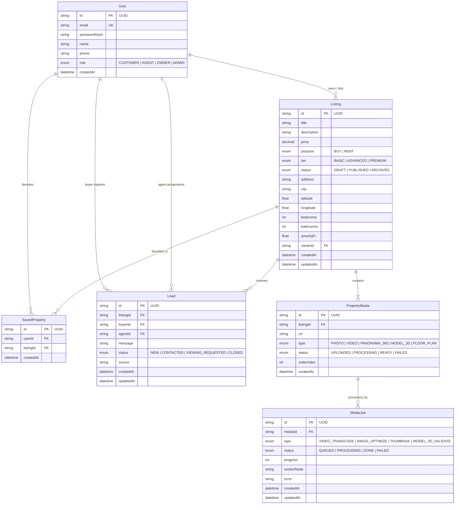
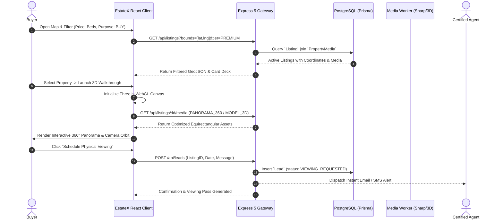

# EstateX — Next-Gen 3D & Spatial Real Estate Marketplace

<div align="center">


**A high-fidelity spatial real estate marketplace featuring 3D virtual walkthroughs, 360° panorama viewing, GIS interactive map exploration, and asynchronous media processing pipelines.**

[System Architecture](#-system-architecture) • [Database ERD](#-database-entity-relationship-diagram) • [3D Tour Sequence](#-spatial-property-exploration-flow) • [Quick Start](#-quick-start)

</div>

---

## ⚡ Overview

**EstateX** bridges physical property inspections and digital buying experiences. Built with **Three.js** and **WebGL**, prospective buyers can step inside 3D property models and 360° panoramic spaces directly inside their web browser, filter listings via interactive **Leaflet GIS** geospatial pins, and instantly submit viewing leads to certified agents.

---

## 🏗 System Architecture



---

## 📊 Database Entity-Relationship Diagram



---

## 🔄 Spatial Property Exploration Flow



---

## 📦 Key Capabilities

- **3D Spatial Walkthroughs**: WebGL-powered 360° virtual tours and interactive 3D model orbit with zero plugins required.
- **Interactive GIS Map Search**: Real-time Leaflet map synchronization with bounding-box queries for neighborhood exploration.
- **Asynchronous Media Engine**: Background Sharp pipeline automatically generates WebP thumbnails, responsive viewports, and validates GLTF/GLB models.
- **Lead Pipeline CRM**: Built-in routing of buyer viewing requests directly to listing agents with status tracking.
- **Tiered Listing System**: Support for `BASIC`, `ADVANCED`, and `PREMIUM` property exposure.

---

## 🚀 Quick Start

### Prerequisites
- Node.js >= 20.x
- PostgreSQL database
- Docker (optional for local DB)
- `pnpm` (`npm install -g pnpm`)

### Installation & Run
```bash
# 1. Clone & Install Dependencies
pnpm install

# 2. Configure Environment
cp .env.example .env
# Set DATABASE_URL, JWT_SECRET, PORT=5000

# 3. Database Migration & Seed
pnpm run db:up         # Starts PostgreSQL via Docker Compose
pnpm run db:push       # Pushes Prisma schema to DB
pnpm run db:seed       # Populates sample properties & 3D media

# 4. Start Development Server (Full Stack)
pnpm run dev
```

Open `http://localhost:5173` to explore EstateX.

---

## 📄 License
Proprietary & Confidential — Engineered by **[Ros Rendo](https://github.com/RosRendo)**